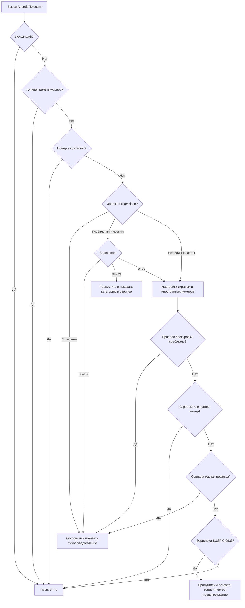

# CallGuard


[](LICENSE)

**Локальная защита от спам-звонков для Android с архитектурой Privacy-first Hybrid.**

CallGuard проверяет входящие звонки на устройстве, учитывает контакты и пользовательские правила,
отклоняет подтверждённый спам и предупреждает о подозрительных звонках без их автоматической блокировки.
Интерфейс поддерживает английский, русский, узбекский и системную светлую/тёмную тему.

> MVP содержит локальную заглушку глобальной базы. Реальный сервер синхронизации и API жалоб
> не подключены. Данные звонков и контактов не отправляются на сервер.

## Содержание

- [Возможности](#возможности)
- [Фильтрация звонков](#фильтрация-звонков)
- [Приватность и данные](#приватность-и-данные)
- [Стек технологий](#стек-технологий)
- [Разрешения](#разрешения)
- [Сборка и запуск](#сборка-и-запуск)
- [Проверки](#проверки)
- [Структура проекта](#структура-проекта)
- [Ограничения MVP](#ограничения-mvp)
- [Лицензия](#лицензия)

## Возможности

| Возможность | Поведение |
| --- | --- |
| История | Секции «Сегодня», «Вчера», «Ранее»; повторы одного номера за день объединяются со счётчиком |
| Локальная спам-база | Добавление, удаление и перенос номера из истории в спам одной транзакцией |
| Smart Rules | Скрытые номера, иностранные номера вне `+998`, маски вида `+99871*` |
| Режим курьера | Пауза всех фильтров на 30 минут или час с автоматическим истечением |
| Контакты | При предоставленном доступе знакомые номера пропускаются до спам-проверок |
| Глобальная оценка | Score `80–100`: отклонение; `30–79`: предупреждение; `0–29`: остальные проверки |
| TTL | Глобальные записи старше 14 дней не участвуют в проверке базы и удаляются при синхронизации |
| Эвристика | Ночные звонки `23:00–07:00`, необычная длина, подозрительные паттерны и префиксы |
| Caller ID Overlay | Предупреждение поверх экрана; закрывается вручную или через 10 секунд |
| Тихие уведомления | Отклонённые звонки отображаются без звука и вибрации в отдельном канале |
| JSON-обмен | Экспорт файла через системное меню «Поделиться», импорт без перезаписи дубликатов |
| Жалоба по звонку | Локальная заявка только из карточки истории, с проверкой существования записи |
| Дашборд | Реактивное количество записей в спам-базе; это не счётчик отклонённых звонков |
| Локализация и темы | EN по умолчанию, RU/UZ по языку системы; Material 3, светлая/тёмная тема |

## Фильтрация звонков

Основной сервис — [CallScreeningServiceImpl](app/src/main/java/uz/callguard/app/CallScreeningServiceImpl.kt).
Порядок проверок реализован в [CallProtectionEngine](app/src/main/java/uz/callguard/app/heuristic/CallProtectionEngine.kt).
Каждое окончательное решение останавливает дальнейшие проверки.



Особенности текущего порядка:

- Курьер и контакты имеют приоритет над базой и масками.
- Глобальное решение `30–79` пропускает звонок с категорией, не переходя к маскам.
- Просроченная или низко оценённая глобальная запись сама по себе не блокирует звонок:
  затем могут сработать пользовательские правила или эвристика.
- Эвристика только предупреждает. Она не отклоняет и не заглушает звонок.
- На основную обработку установлен таймаут 2,5 секунды; при ошибке или таймауте звонок пропускается.
- Оверлей необязателен для блокировки: без специального разрешения окно не показывается.

## Приватность и данные

### Локальные и глобальные записи

Room хранит SHA-256 нормализованного номера, источник, число отметок и временные метки.
У пользовательских записей может храниться читаемый номер для интерфейса и JSON-экспорта.
История содержит номера и результаты проверок. **Хэширование не означает шифрование базы**
и не делает телефонные номера гарантированно анонимными.

Схема базы — версия **5**. Для переходов `2 → 3 → 4 → 5` зарегистрированы миграции.
Существующие записи при переходе `4 → 5` сохраняются как локальные, с `spamScore = 100`.
Для неизвестных путей обновления пока включён `fallbackToDestructiveMigration(true)`:
такой переход может удалить данные. Перед изменением схемы учитывайте это поведение.

### Фоновая синхронизация

[GlobalSpamSyncWorker](app/src/main/java/uz/callguard/app/sync/GlobalSpamSyncWorker.kt)
зарегистрирован в `CallGuardApplication` как уникальная периодическая задача раз в сутки.
Android может отложить её выполнение из-за ограничений фоновой работы.

Текущий источник — `GlobalSpamFeed.stubJson`: два синтетических хэша с категориями и оценками,
без реальных телефонных номеров и HTTP-запросов. Worker:

1. Разбирает JSON и валидирует поля.
2. Сохраняет глобальные записи без открытых номеров.
3. Обновляет только глобальные записи, не перезаписывая локальные.
4. Удаляет глобальные записи, не обновлявшиеся более 14 дней.

Даже если Worker задержался, фильтр самостоятельно исключает просроченные записи.

### Импорт, экспорт и жалобы

- Экспорт создаёт JSON версии **2** и передаёт файл через `FileProvider` с временным доступом на чтение.
- JSON может содержать сохранённые телефонные номера. Файл передаётся только по действию пользователя.
- Импорт поддерживает версии **1/2** и старые массивы записей. Максимальный размер — **5 МБ**, до **50 000** записей.
- Перед сохранением проверяется весь файл. Вставка выполняется транзакционно через `IGNORE` для дубликатов.
- Жалоба сохраняется в локальной таблице `pending_spam_reports` с ID звонка, хэшем и временем создания.
  Отправки на сервер нет; Worker жалобы не выгружает.
- Резервное копирование приложения через Android отключено в манифесте.

## Стек технологий

| Компонент | Технология / версия |
| --- | --- |
| Платформа | Android 10+ (`minSdk 29`), `targetSdk 34`, `compileSdk 37.1` |
| Язык | Kotlin `2.2.10`, JVM target 11 |
| UI | Jetpack Compose BOM `2026.02.01`, Material 3, Rounded Icons |
| Состояние | ViewModel, Coroutines `1.9.0`, StateFlow, lifecycle-aware collection |
| Локальная БД | Room `2.7.1`, KSP `2.2.10-2.0.2` |
| Настройки | Preferences DataStore `1.1.3` |
| Фоновые задачи | WorkManager `2.10.1`, CoroutineWorker |
| JSON | Gson `2.11.0` |
| Телефония | CallScreeningService, RoleManager, Contacts Provider |
| Оверлей | WindowManager, `TYPE_APPLICATION_OVERLAY` |
| Сборка | Gradle Wrapper `9.4.1`, Android Gradle Plugin `9.2.1`, JDK 21 |
| Тесты | JUnit 4, AndroidX Test / Compose Test; Python 3 + SQLite для проверки SQL-миграции |

Точные зависимости: [каталог версий](gradle/libs.versions.toml) и [модуль приложения](app/build.gradle.kts).

## Разрешения

| Разрешение / роль | Зачем нужно | Как предоставляется |
| --- | --- | --- |
| `ROLE_CALL_SCREENING` | Основная проверка и отклонение звонков | Системный запрос роли из онбординга, API 29+ |
| `READ_CONTACTS` | Исключение знакомых номеров из спам-проверок | Runtime-запрос в настройках приложения |
| `POST_NOTIFICATIONS` | Тихие уведомления о блокировках | Runtime-запрос на Android 13+; отказ не отключает фильтр |
| `SYSTEM_ALERT_WINDOW` | Предупреждение поверх экрана звонка | Специальный экран Android из онбординга или настроек |
| `READ_PHONE_STATE` | Объявлен для работы с состоянием телефонии | Наличие декларации не означает выдачу runtime-разрешения |
| `BIND_SCREENING_SERVICE` | Защита системного подключения к сервису | Атрибут сервиса; обычный пользователь его не выдаёт |
| `BIND_NOTIFICATION_LISTENER_SERVICE` | Подключение резервного слушателя уведомлений дайлера | Специальный доступ Android, выдаётся отдельно |

Основной сценарий использует роль Call Screening. Резервный слушатель уведомлений — best-effort
механизм для некоторых дайлеров: он показывает предупреждения, но не заменяет гарантированное
отклонение через Telecom. Доступ к уведомлениям других приложений отличается от `POST_NOTIFICATIONS`.

Для JSON-обмена разрешение на доступ ко всему хранилищу не требуется: используются системный
выбор файла и временные URI-разрешения. Зависимости WorkManager могут добавлять служебные
разрешения через объединение манифестов.

## Сборка и запуск

### Требования

- Полный **JDK 21**, включая `javac`.
- Android SDK Platform **37.1**, Build Tools **36.0.0**, Platform Tools.
- Android Studio с поддержкой версий Gradle/AGP проекта либо командная строка.
- Для запуска — устройство или эмулятор Android 10+. Проверку реальных звонков проводите на устройстве.

### Получение проекта

```bash
git clone --branch main https://github.com/elyor-bek/CallGuard.git
cd CallGuard
```

Укажите SDK через `ANDROID_HOME` или локальный, не добавляемый в Git файл `local.properties`:

```properties
sdk.dir=/absolute/path/to/Android/Sdk
```

При наличии Android command-line tools установите компоненты и примите лицензии:

```bash
sdkmanager "platforms;android-37.1" "build-tools;36.0.0" "platform-tools"
sdkmanager --licenses
```

### Debug APK

```bash
bash gradlew :app:assembleDebug
```

Результат: `app/build/outputs/apk/debug/app-debug.apk`.
Используется `bash gradlew`, поскольку wrapper в репозитории может не иметь executable-бита.
На Windows используйте `gradlew.bat :app:assembleDebug`.

Установка на подключённое устройство:

```bash
adb install -r app/build/outputs/apk/debug/app-debug.apk
```

При первом запуске выберите CallGuard для фильтрации вызовов, разрешите уведомления и,
при необходимости, отображение поверх окон. Доступ к контактам настраивается отдельно.

> AGP 9.2.1 предупреждает, что проверен до SDK 37.0, тогда как проект использует SDK 37.1.
> Debug-сборка проверена с этим предупреждением. Не отключайте TLS, подписи или проверки артефактов
> для обхода проблем установки зависимостей.

## Проверки

```bash
bash gradlew :app:assembleDebug :app:testDebugUnitTest :app:lintDebug
python3 tools/verify_hybrid_migration.py
```

Python-проверку запускайте после сборки: она использует сгенерированную Room-схему.
Она сравнивает SQL-схему после миграции `4 → 5` с новой схемой, проверяет сохранность данных,
TTL и защиту локальных записей от глобальных обновлений. Это не заменяет миграционный тест на Android.

Последняя проверка MVP в облачной среде: **40 unit-тестов пройдено**, debug APK собран,
Lint завершился без ошибок, но с предупреждениями. Это результат локального запуска, не статус CI.

| Область | Что проверяется |
| --- | --- |
| История | Группировка, нормализация, стабильность ключей, границы дней и DST |
| Курьер | Точное окончание паузы и округление оставшегося времени |
| Пайплайн | Приоритет курьера, контактов и базы перед следующими проверками |
| Smart Rules | Формат масок, префиксы, скрытые и иностранные номера |
| Эвристика | Ночной период, контакты, длина и паттерны номера; отсутствие автоматического отклонения |
| JSON | Round-trip, дубликаты, неверный формат, размер и согласованность номера с хэшем |
| Hybrid | Границы score 29/30/79/80, TTL, hash-only feed, сохранение метаданных |

Отчёты находятся в `app/build/reports/`, XML-результаты — в `app/build/test-results/`.
Периодическое выполнение Worker, системные диалоги, оверлей во время реального звонка
и взаимодействие с конкретными дайлерами требуют отдельной проверки на устройствах.

## Структура проекта

```text
app/src/main/
├── AndroidManifest.xml
├── java/uz/callguard/app/
│   ├── CallGuardApplication.kt       # регистрация ежедневной задачи
│   ├── CallScreeningServiceImpl.kt   # ответ Android Telecom
│   ├── MainActivity.kt               # роль, разрешения и навигация
│   ├── data/                        # Room, DataStore, JSON, SpamPolicy
│   ├── heuristic/                   # порядок проверок и локальные эвристики
│   ├── notification/                # тихие уведомления и резервный слушатель
│   ├── overlay/                     # окно предупреждения и автоудаление
│   ├── sync/                        # Worker и заглушка глобального feed
│   ├── ui/                          # Compose-экраны, ViewModel и тема
│   └── whitelist/                   # проверка контактов
└── res/                             # EN/RU/UZ, ночная тема и XML-оверлей
app/src/test/                        # JVM unit-тесты
tools/verify_hybrid_migration.py      # SQL-проверка миграции
```

## Ограничения MVP

- Глобальная база демонстрационная; сетевой источник и сервер жалоб ещё не реализованы.
- Синхронизация не подтверждает отправку жалоб: все заявки остаются на устройстве.
- Эвристические диапазоны VoIP/спуфинга предварительные и могут давать ложные предупреждения.
- Скрытые звонки доступны приложению только тогда, когда Android/дайлер передаёт их сервису.
- Работа в фоне и показ поверх звонка зависят от Android, выданных разрешений и прошивки устройства.
- Сборка `assembleDebug` не является подписанным production-релизом для магазина.

## Лицензия

Проект распространяется под [лицензией MIT](LICENSE).
Она разрешает использование, изменение и распространение с сохранением уведомления об авторских правах.
Сторонние библиотеки распространяются на условиях собственных лицензий.
